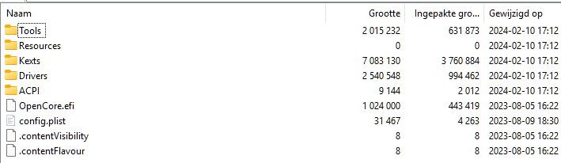

# hp-15-ec0xxx-hackintosh
efi files, ssdts, acpi tables, kexts required for booting monterey on a hp pavilion 15 ec0xxx (ryzen 5 3550h / vega 8, gtx 1050 mobile) laptop. no gpu accel. ethernet works, integrated keyboard and usb mouse (razer deathadder) works too. safari and terminal works as expected inside the installer, and used it to chat on discord while it still supported monterey safari. made in 2023-2024 so doesn't use any of the new vibecoded projects or anything. hopefully someone can do something with it, but i just wanted to share this somewhere xd  
i'm unlikely to ever install or boot macos on here again cuz im not made out of disk space O_O  
k nuff rambling, open those dirs already  

